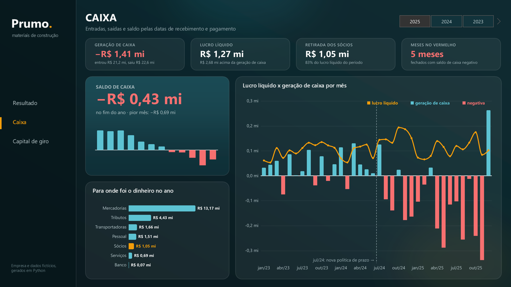
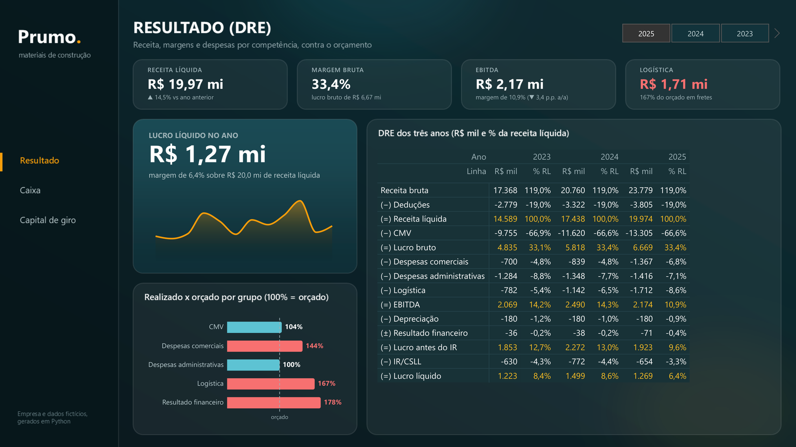
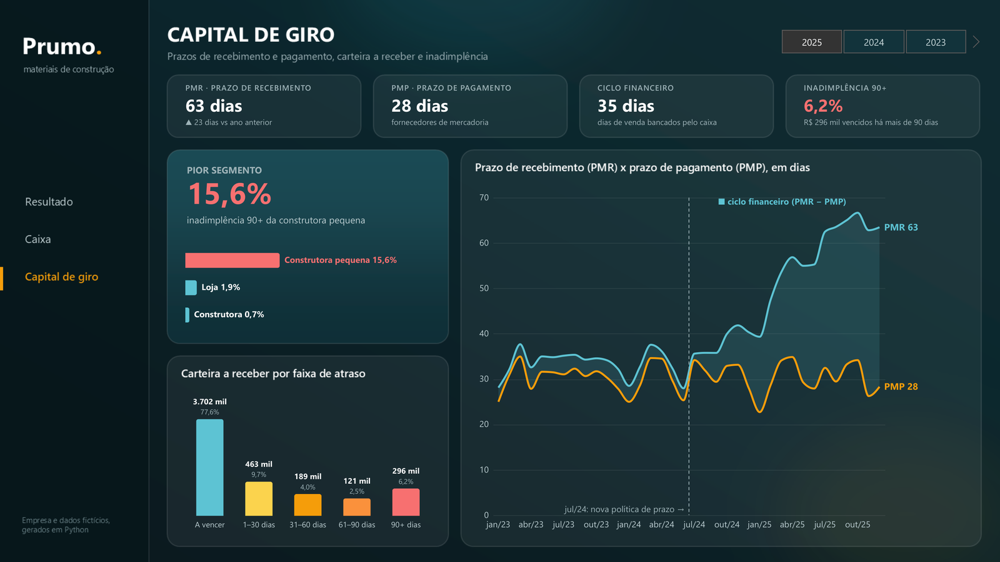

# Financeiro de uma PME: vende mais e dá lucro, por que falta caixa?

Dashboard em Power BI com DRE, fluxo de caixa e capital de giro de uma distribuidora de materiais de construção, de jan/2023 a dez/2025.

> **A empresa e os dados são fictícios.** A *Prumo Materiais* não existe: todos os números saem de um gerador em Python incluído neste repositório ([`gerador/gerar_dados.py`](gerador/gerar_dados.py)), com semente fixa. Quem clona gera exatamente os mesmos dados.



## O problema

A Prumo vende cada vez mais (receita bruta de R$ 17,4 mi em 2023 para R$ 23,8 mi em 2025) e fecha os três anos no lucro. Mesmo assim, em 2025 o caixa fica negativo e a empresa passa a pagar juros de capital de giro. A pergunta deste estudo: **se a empresa lucra, para onde foi o dinheiro?**

## Perguntas de negócio

| # | Pergunta | Página |
|---|----------|--------|
| 1 | A empresa está crescendo com rentabilidade? Margens e lucro contra o ano anterior | Resultado |
| 2 | Onde o realizado fugiu do orçamento? | Resultado |
| 3 | Lucro virou caixa? Em que meses o saldo ficou negativo? | Caixa |
| 4 | Para onde vai o dinheiro que sai? | Caixa |
| 5 | Em quantos dias a empresa recebe e em quantos paga? | Capital de giro |
| 6 | Quem está atrasando, e há quanto tempo? | Capital de giro |

## Dados

Gerados por [`gerador/gerar_dados.py`](gerador/gerar_dados.py) (Python, pandas e numpy). A "história" fica em parâmetros nomeados no topo do script:

- **Vendas** crescem ~17% ao ano, com sazonalidade de construção (jan–fev fracos, pico em set–nov).
- **A virada, em jul/2024:** para vender mais, o comercial passa a dar 60/90 dias de prazo (antes, 28/30) e entra um segmento novo, o de **construtoras pequenas**, que atrasa e dá calote mais que os outros.
- **Fornecedores não acompanham:** continuam cobrando em 30 dias.
- **O frete sai do controle em 2025.**
- **Os sócios retiram 80% do lucro** do mês no mês seguinte. Só que o lucro está a receber, não no banco.

| Arquivo | Grão |
|---|---|
| `lancamentos.csv` | 1 lançamento da DRE (regime de competência) |
| `orcamento.csv` | 1 mês x conta |
| `titulos_receber.csv` / `titulos_pagar.csv` | 1 parcela, com emissão, vencimento e baixa (regime de caixa) |
| `plano_contas.csv`, `clientes.csv`, `fornecedores.csv`, `saldo_inicial.csv` | cadastros |

Os dados são **coerentes entre si**: a receita da DRE é a soma das vendas, os títulos a receber são essas vendas parceladas, e o caixa sai das baixas reais dos títulos. O [`gerador/test_gerar_dados.py`](gerador/test_gerar_dados.py) confere isso e confere também a história, com 12 testes: as vendas crescem, o PMR sobe e o PMP fica, a inadimplência sobe, o frete estoura, o lucro é positivo mas a margem cai, e o caixa fica negativo só em 2025. Se alguém mexer num parâmetro e a história quebrar, o teste avisa.

## Modelagem

Esquema estrela com **quatro fatos**, dois em regime de competência e dois em regime de caixa:

```
                       Calendário
            /          |           |           \
  Lançamentos      Orçamento   Títulos a     Títulos a
  (competência)    (mensal)     receber        pagar
            \         /            |             |
         Plano de contas        Clientes     Fornecedores
             |
         Linhas DRE (estrutura da DRE, com subtotais)
```

Quatro decisões de modelagem que fazem diferença:

- **O orçamento é mensal; o calendário é diário.** Cada linha do orçamento usa o 1º dia do mês como data, e o relacionamento é feito por ela. Num filtro por mês ou ano, o orçado soma certo; num filtro por dia, não faz sentido e não é usado.
- **Títulos têm várias datas.** O relacionamento ativo é pela emissão (venda e compra); os pela data de baixa ficam **inativos** e são ligados só nas medidas de caixa, com `USERELATIONSHIP`.
- **O "hoje" do relatório é a data de referência**, o último dia do período filtrado, nunca `TODAY()`. Saldo a receber, aging, PMR e inadimplência são fotografias nessa data.
- **A DRE tem linhas de subtotal** (Receita líquida, Lucro bruto, EBITDA, Lucro líquido) que não existem no plano de contas. A tabela `Linhas DRE` traz cada linha com tipo (grupo ou subtotal) e ordem, e uma única medida resolve as duas coisas.

### DAX

São 37 medidas na tabela `_Medidas`, em pastas (Resultado, Orçamento, Caixa, Capital de giro), conferidas contra o Python até o centavo. Alguns exemplos:

```dax
-- Uma medida para a DRE inteira: grupo soma a própria ordem; subtotal soma tudo acima dele
Valor DRE =
    VAR _ordem = SELECTEDVALUE('Linhas DRE'[Ordem])
    RETURN
        SWITCH(
            SELECTEDVALUE('Linhas DRE'[Tipo]),
            "Grupo", CALCULATE([Resultado], 'Plano de contas'[Ordem DRE] = _ordem),
            "Subtotal", CALCULATE([Resultado], 'Plano de contas'[Ordem DRE] < _ordem)
        )

-- Caixa pela data de baixa (relacionamento inativo)
Entradas =
    CALCULATE(
        SUM('Títulos a receber'[Valor recebido]),
        USERELATIONSHIP('Títulos a receber'[Data recebimento], 'Calendário'[Data]),
        'Calendário'
    )

-- Saldo acumulado desde o início, até o último dia do contexto
Saldo de caixa =
    VAR _ref = MAX('Calendário'[Data])
    RETURN
        IF(NOT ISBLANK(_ref),
            [Saldo inicial] + CALCULATE([Geração de caixa], REMOVEFILTERS('Calendário'), 'Calendário'[Data] <= _ref))

-- Prazo médio de recebimento: quantos dias de venda estão a receber
PMR = DIVIDE([A receber], [Vendas 90 dias]) * 90
```

Também há inteligência de tempo (`SAMEPERIODLASTYEAR`, `TOTALYTD`, `DATESINPERIOD` para 12 meses móveis), realizado x orçado por linha da DRE e aging por faixas de atraso.

**Visual:** tema escuro próprio, cartões de indicadores em HTML (visual *HTML Content*) que se recalculam com o filtro de ano, gráficos em **Deneb** (Vega-Lite) e fundos das páginas gerados por script ([`layout/gerar_fundos.py`](layout/gerar_fundos.py), que desenha no PowerPoint e exporta os PNGs).

## Dashboard

**Resultado:** cartões do ano escolhido contra o anterior, lucro líquido mês a mês, realizado x orçado por grupo de despesa e a DRE dos três anos lado a lado, com análise vertical (% da receita líquida).



**Caixa:** geração de caixa, lucro, retirada dos sócios e meses no vermelho; o saldo no fim de cada mês; para onde foi o dinheiro; e o gráfico-chave: lucro líquido x geração de caixa por mês. Até jun/24 os dois andam juntos; depois da nova política de prazo, o lucro segue positivo e o caixa afunda.


**Capital de giro:** PMR, PMP, ciclo financeiro e inadimplência 90+; a inadimplência por segmento; a carteira a receber por faixa de atraso (aging); e PMR x PMP mês a mês, com a área entre as linhas mostrando o ciclo financeiro que se abre depois de jul/24.



## Conclusões

1. **Vender mais não foi o problema.** A receita bruta cresceu 37% em dois anos (R$ 17,4 mi → R$ 23,8 mi), e a margem bruta ficou estável em ~33%.
2. **Lucro não é caixa.** Em 2025 a empresa lucrou **R$ 1,27 mi**, mas a geração de caixa foi de **−R$ 1,41 mi**. O saldo ficou negativo em **5 meses** (mínimo de −R$ 688 mil; fechou o ano em −R$ 0,43 mi), e apareceram juros de capital de giro. Mesmo assim, os sócios retiraram **R$ 1,05 mi**, 83% do lucro.
3. **O dinheiro ficou na mão dos clientes.** O PMR foi de **32 para 63 dias**, enquanto os fornecedores seguem cobrando em ~28. A empresa paga antes de receber e banca **35 dias** de venda com o próprio caixa (ciclo financeiro).
4. **O segmento novo é o principal culpado.** A inadimplência acima de 90 dias triplicou (**2,2% → 6,2%**). Nas construtoras pequenas, ela chega a **15,6%**.
5. **E as despesas fugiram do orçamento:** em 2025, a logística (frete) custou **167%** do orçado e as despesas comerciais, **144%**. A margem EBITDA caiu de 14,3% para 10,9%, e a margem líquida, de 8,6% para 6,4%.

**O que fazer:** rever o prazo e o crédito das construtoras pequenas (análise de crédito, entrada, limite por cliente), renegociar prazo com os fornecedores para reduzir o ciclo financeiro, atrelar a retirada dos sócios ao caixa e não ao lucro, e investigar o contrato de frete e as despesas comerciais.

## Como reproduzir

1. Gere os dados (Python 3 com pandas e numpy):
   ```
   python gerador/gerar_dados.py
   python -m pytest gerador
   ```
   O primeiro comando grava os CSVs em `data/` (fora do Git); o segundo confere se a história está nos números.
2. Abra `pbip/bi-financeiro.pbip` no Power BI Desktop (formato Power BI Project, com o modelo em TMDL).
3. Em **Transformar dados → Gerenciar parâmetros**, aponte `PastaDados` para a sua pasta `data\` (com a barra no final) e atualize.
4. Os visuais Deneb e HTML Content vêm do AppSource. Se não carregarem, instale-os em **Mais visuais → Obter mais visuais**.

## Estrutura

```
gerador/                         gerador dos dados e testes da história
pbip/
  bi-financeiro.SemanticModel/   modelo: tabelas, relacionamentos e medidas (TMDL)
  bi-financeiro.Report/          páginas, visuais, tema e fundos (PBIR)
layout/                          fundos das páginas (script, PowerPoint e PNG)
docs/                            prints do dashboard
data/                            CSVs gerados (fora do Git)
```
